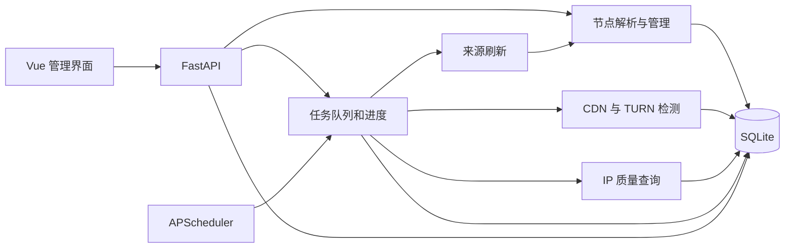

# NodeMaster 技术方案

2026-11-23。工作区原为空，无 Git 历史或旧代码可复用。Windows 上检查到 Python 3.14 与 Node.js 24，项目面向 Python 3.11 及以上。应用为单用户本地服务。只有用户导入或启用的来源进入任务，启动时无预设外网检测任务。

## 调研和取舍

日期来自项目的 GitHub 推送或发行记录，许可证以各项目公开文件为准。库许可证与第三方 API 的账号配额、数据留存条款分别适用。

| 工具 | 维护、平台及许可证 | 批量与接入方式 |
| --- | --- | --- |
| [CloudflareSpeedTest](https://github.com/XIU2/CloudflareSpeedTest/releases/tag/v2.3.5) | 2026-04-29 发布 v2.3.5，2026-09 有推送。Windows CLI，GPL-3.0。 | 支持批量测速和 CSV。接收其 CSV 作为候选，再用本轮目标测速。应用不分发其二进制。网段的可选来源是 [Cloudflare 官方公开列表](https://www.cloudflare.com/ips/)。 |
| [aioice](https://github.com/aiortc/aioice) | 2026-11 有推送与 0.13.0 标签，BSD-3-Clause，Python/asyncio。 | Python API 可并发调度。复用 STUN 消息及 TURN 事务、认证、Allocate 和 ChannelBind 客户端。完整中继测试需要用户配置可直接访问且由用户控制的 UDP 回显。 |
| [coturn](https://github.com/coturn/coturn) | 2026-11 发布容器构建，[许可证](https://github.com/coturn/coturn/blob/master/LICENSE) 为 BSD 风格。主要运行在 Linux，Windows 可用 WSL 或 Docker。 | 附带 CLI 测试工具，适合协议交叉验证。Windows 主程序不要求安装 coturn。 |
| [Mihomo](https://github.com/MetaCubeX/mihomo/releases/tag/v1.19.34) | 2026-11 发布，MIT，有 Windows 二进制。 | 以 [Mihomo 代理文档](https://wiki.metacubex.one/config/proxies/) 为 Clash 格式参考。使用用户已运行的 HTTP/SOCKS5 代理测量出口，首版不内置转发核心。 |
| [subconverter](https://github.com/tindy2013/subconverter) | 2024-04 发布 v0.9.0，2026-07 有推送，GPL-3.0，有 Windows CLI 和 HTTP 服务。 | 可批量转换订阅。首版处理已知格式，其他格式可在本机预转换。应用不使用在线订阅转换服务。 |
| [HTTPX](https://github.com/encode/httpx) / [h11](https://github.com/python-hyper/h11) | HTTPX 2026-11 有推送，BSD-3-Clause。h11 2025-04 有推送，MIT。Python 跨平台。 | HTTPX 异步获取来源和信誉数据，并支持 SOCKS。CDN 测速用 asyncio 直连候选 IP 与 h11 解析 HTTP/1.1，分别计时 TCP、TLS、TTFB 和限量下载。 |
| [IPinfo Python](https://github.com/ipinfo/python) / [MaxMind GeoIP2](https://github.com/maxmind/GeoIP2-python) | 两库在 2026 年有推送，Apache-2.0，可在 Windows 运行。 | 用 [IPinfo REST API](https://ipinfo.io/developers) 获取地理和 ASN，直接通过 HTTPX 接入。MaxMind 可在取得授权数据库后扩展为离线查询。 |
| [AbuseIPDB](https://docs.abuseipdb.com/#check-endpoint) | 有公开 HTTPS API，Windows 可通过 HTTPX 调用。账号配额和留存条款以服务文档为准。 | 按 IP 查询和缓存。记录服务、请求时间、失败或限流，对缺失信息保留未知状态。 |
| [APScheduler](https://github.com/agronholm/apscheduler/releases/tag/3.11.3) | 2026-06 发布 3.11.3，2026-11 有推送，MIT，Python 跨平台。 | AsyncIO 调度器恢复 SQLite 中的任务计划，通过应用队列触发实际任务。 |
| [zizifn/edgetunnel](https://github.com/zizifn/edgetunnel) | 调研查到的最新 GitHub Release 为 2023-05 的 v2.0，部署在 Cloudflare 运行时。 | EdgeTunnel 有多个实现，尚无当前分支的配置样本。提供通用每行一个地址的导出与自定义文本模板。 |

用外部工具能较快得到测速数据，但阶段指标、退出行为和 Windows 安装较难统一。完全自研协议会增加验证成本。采用 FastAPI、Vue 3 + TypeScript、SQLite 和专用协议库，通过适配层统一阶段指标和错误类别。Windows 启动只需一个本地 Web 进程。

## 模块关系

每次任务先持久化。启动时把上次未结束的任务标记为中断，并从启用计划重建调度。浏览器轮询任务，节点详情加载检测历史。SQLite 使用 WAL、事务、外键和 user_version 顺序迁移。普通查询仅提供配置摘要，订阅地址、完整原配置和密钥加密保存。

## 数据和接口

| 数据表 | 键和用途 |
| --- | --- |
| nodes | 节点 ID，规范化的协议、地址、端口和有效连接配置组成加密指纹。软删除后保留历史。 |
| sources / node_sources | 保存来源配置、关联、最近见到时间与刷新状态。可对应多个来源。 |
| tasks / results | 一轮任务含多个不可变结果，保存检测类型、目标快照、分阶段耗时、成功率、分数及诊断。 |
| quality_checks | 规范化 IP、数据源、查询时间、原始值、规范化结果与失败类别，不同节点共用缓存。 |
| settings / schedules | 保存评分权重、刷新策略、并发、周期等。对密钥值单独加密，普通接口不返回。 |

| API | 用途 |
| --- | --- |
| GET /api/summary、GET /api/nodes | 仪表盘及节点分页、搜索、筛选。 |
| POST /api/import、POST /api/nodes/actions、POST /api/export | 文件和手动导入、批量管理、筛选导出。 |
| GET /api/nodes/{id}、POST /api/nodes/{id}/configuration | 节点历史及 IP 质量，单独显式查看敏感配置。 |
| GET/POST /api/sources、PATCH/DELETE /api/sources/{id} | 添加、启停与删除来源。 |
| GET/POST /api/tasks、GET /api/tasks/{id}、POST /api/tasks/{id}/cancel | 刷新、检测、质量与自动流程，查询进度和取消。 |
| GET/PUT /api/settings、GET/POST /api/schedules | 检测参数与计划管理。 |
| POST /api/exit-ip | 分别查询直连或用户配置的本地代理出口。 |

CDN 测速用候选 IP 建立连接并使用独立的 SNI、Host 和路径。只从用户选择的 CIDR 生成有上限的候选，远程名单设置响应大小上限，无自动重定向。可比历史要匹配目标、检测级别及条件，区分未入本轮名单、失败和性能下降。新优选名单是查询视图；更新策略默认保留旧结果。

TURN 快速、标准和完整等级分别以连通/Binding、成功 Allocate、真实双向回显为上限。每种配置单独记录。回显端点未配置时，Allocate 可以独立确认，中继阶段保留为未验证。节点端点、CDN 候选和代理出口分别呈现。未支持实际连接检测的代理协议只提供管理和导出。

## 实施验收

1. 数据和节点。验证 URI、各文件格式往返、去重、来源关联以及普通查询不泄露凭据。
2. CDN、TURN 与队列。用本地 HTTP/TLS、STUN/TURN 和 UDP 回显验证阶段结果、重试、并发、取消与保存。
3. 来源、质量、自动化。用模拟 HTTP 验证远程 CSV、CIDR 抽样、API 解析和缓存、失败回退、历史对比、排名和计划恢复。
4. 界面与交付。通过类型检查与生产构建，实测页面导入、检测、轮询、历史与下载。验证 Windows 安装、启动和停止脚本，记录实测范围。
